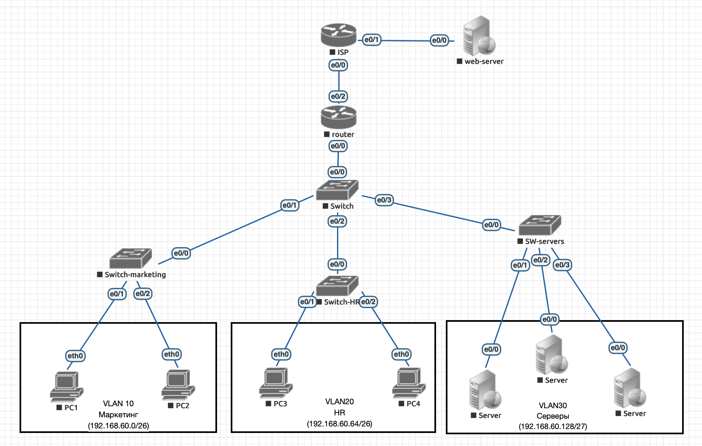

Лабораторная работа: Построение корпоративной сети компании Сфера 

Цель
 - Построить корпоративную сеть, в которой:
 - отделы Marketing, HR и Servers изолированы в отдельных VLAN
 - связь между VLAN идет через один физический интерфейс роутера
 - клиенты получают адреса по DHCP
 - все узлы выходят в интернет через NAT
 - веб-сервер из VLAN 30 доступен снаружи
 - Marketing не имеет доступа к HR

## Топология
Провайдер `(203.0.113.1/29)` подключен к порту роутера `e0/2 (203.0.113.5)`. Узел `8.8.8.8` имитирует интернет.
Роутер соединен с центральным коммутатором `Switch (core)` транком `e0/0 - e0/0`. От ядра три транка к коммутаторам доступа,
все они приходят в порт `e0/0` коммутаторов: `core e0/1` к `Switch-marketing`, `core e0/2 к Switch-HR`, `core e0/3` к `SW-servers`.
Оконечные устройства: `Switch-marketing PC1` и `PC2 (VLAN 10, DHCP)`, `Switch-HR PC3` и `PC4 (VLAN 20, DHCP)`, `SW-servers Server1` `192.168.60.130/27`, 
`Server2 192.168.60.131/27` и `Server3 192.168.60.132/27` (VLAN 30, статические адреса).
Единственный путь между VLAN проходит через роутер, поэтому весь межвлановый трафик и ACL обрабатываются на его сабинтерфейсах.

## Адресация
Одна сеть `192.168.60.0/24` разбита на подсети разной длины под реальное число хостов.
VLAN 10 MARKETING: `192.168.60.0/26`, шлюз `192.168.60.1`
VLAN 20 HR: `192.168.60.64/26`, шлюз `192.168.60.65`
VLAN 30 SERVERS: `192.168.60.128/27`, шлюз `192.168.60.129`
Линк к провайдеру: `203.0.113.0/29`, адрес роутера `203.0.113.5`, шлюз провайдера `203.0.113.1`

## 1. VLAN и транки
На всех коммутаторах созданы VLAN 10 (MARKETING), 20 (HR) и 30 (SERVERS). Порты между коммутаторами работают как транки.
На центральном коммутаторе все четыре порта `(Et0/0 - Et0/3)` работают как транки, разрешены VLAN 10, 20 и 3.
На коммутаторах доступа порт Et0/0 транковый и смотрит в сторону ядра, остальные порты назначены в VLAN своего отдела:
SW-MARKETING: порты `Et0/1` и `Et0/2` в VLAN 10
SW-HR: порты `Et0/1` и `Et0/2` в VLAN 20
SW-SERVERS: порты `Et0/1`, `Et0/2` и `Et0/3` в VLAN 30

## 2. Router-on-a-stick
Физический интерфейс Ethernet0/0 роутера не имеет адреса, на нем создано три сабинтерфейса.
Каждый из которых является шлюзом своего VLAN: `Ethernet0/0.10 (192.168.60.1)`, `Ethernet0/0.20 (192.168.60.65)`, `Ethernet0/0.30 (192.168.60.129)`. 
Интерфейс `Ethernet0/2` с адресом `203.0.113.5` смотрит в сторону провайдера. В таблице маршрутизации есть три подключенные сети и статический маршрут по умолчанию через `203.0.113.1`.

## 3. DHCP
Клиенты PC1 и PC3 получили настройки автоматически. PC1 (Marketing) получил `192.168.60.10/26` со шлюзом `192.168.60.1`, PC3 (HR) получил `192.168.60.70/26` со шлюзом `192.168.60.65`. 
На роутере в таблице DHCP видны обе аренды. Серверы настроены статически, например Server2: `192.168.60.131/27`, шлюз `192.168.60.129`.

## 4. NAT
Настроена статическая трансляция, которая публикует веб-сервер из VLAN 30: внешний адрес роутера `203.0.113.5` порт `80` соответствует внутреннему адресу `192.168.60.130` порт `80`. Остальные узлы выходят в интернет через трансляцию адресов.

## 5. ACL
Расширенный список доступа 110 ограничивает трафик из сети Marketing. 
Первые два правила разрешают DHCP-пакеты, иначе клиенты не получат адрес. 
Третье правило запрещает трафик из сети `192.168.60.0/26 (Marketing)` в сеть `192.168.60.64/26 (HR)`, оно сработало 20 раз. 
Четвертое правило разрешает остальной трафик из сети Marketing, оно сработало 25 раз. Счетчики совпадений подтверждают, что правила работают.

## 6. Проверка связности
PC1 (Marketing). Проверка связи с `8.8.8.8` и `203.0.113.1` прошла успешно, значит выход наружу работает.
Связь с сервером `192.168.60.130` успешна, значение ttl равно 63, то есть пакеты проходят через роутер. 
При обращении к `192.168.60.70 (HR)` приходит ответ "Communication administratively prohibited" от `192.168.60.1`: роутер сам отклонил пакет по ACL.
PC3 (HR), выход наружу и доступ к серверу работают. Проверка связи с `192.168.60.10 (Marketing)` заканчивается превышением времени ожидания. 
Запрос доходит до PC1, но ответ блокируется ACL на входе сабинтерфейса VLAN 10, поэтому сообщения об ошибке нет.
Server2 (VLAN 30). Проверка связи с `8.8.8.8` успешна, серверы тоже выходят в интернет.

## Выводы
VLAN изолируют отделы на втором уровне, связь между ними возможна только через роутер. 
Router-on-a-stick позволяет обойтись одним физическим интерфейсом на все VLAN, но этот интерфейс становится узким местом. 
ACL дает управляемую политику доступа: Marketing не может обращаться к HR, остальной трафик проходит. 
Разница между ответом "administratively prohibited" и отсутствием ответа показывает, 
где сработал фильтр: ответ от роутера означает блокировку запроса, тишина означает блокировку ответа. Это полезно при диагностике.
